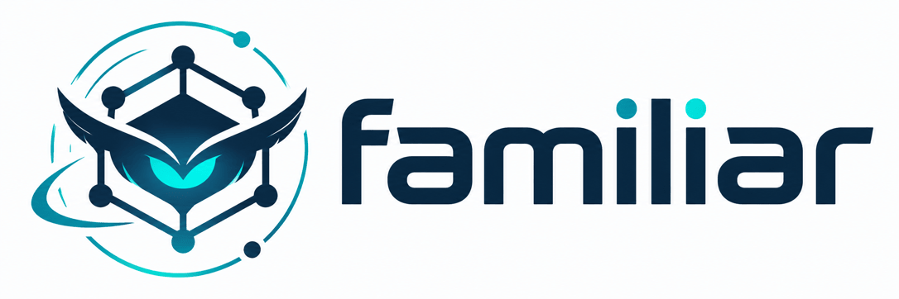

<h1 align="center">
  <picture>
    <source media="(prefers-color-scheme: dark)" srcset="docs/assets/logo-header-dark.png">
    <source media="(prefers-color-scheme: light)" srcset="docs/assets/logo-header.png">
    
  </picture>
</h1>

<p align="center"><em>An always-on AI agent for a home Kubernetes cluster, built on the assumption that
it might turn against you.</em></p>

familiar runs a persistent agent, GIDEON (Generally Intelligent Daemon,
Exceptionally Organized & Nosy; built on [Hermes Agent](https://github.com/NousResearch/hermes-agent)
and Claude), inside a home cluster. It watches the cluster's health, triages
alerts and answers questions over Matrix. It is also a deliberate exercise in the
operational and security patterns that long-running agents need: standing
credentials, persistent memory, untrusted input, and nobody watching at the moment
it acts.

The agent holds **no credentials**. It has no model API key and no Kubernetes
token. Everything privileged goes through a small broker that holds the
credential and enforces a policy the agent can't change, and every guardrail is
structural (network policy, RBAC, brokers) rather than an instruction it's asked
to follow.

## Status

**Phase 1, the read-only watch officer, is built and tested locally; not yet
deployed.** model-gate, the four tool servers, memory-auditor and the manifests are
done, and the whole stack has run against a live cluster from a laptop. Later
phases, in order of risk, are in the [design document](docs/DESIGN.md):
proposing changes as pull requests, a quarantined reader for untrusted input, and
a builder that implements designs.

Images are published to `ghcr.io/runlevel-six/model-gate` and
`ghcr.io/runlevel-six/familiar-tools` for amd64 and arm64.

## What's in it

- **model-gate**, the only holder of the API keys: per-role model, tool and beta
  allowlists, hourly and daily budgets in USD, and an audit line per request. It
  refuses Anthropic's server-side tools, which would let the agent reach the
  internet through the model API.
- **Four read-only tool servers** over MCP: cluster state, fixed Prometheus
  queries, Ceph health and ingress certificates. Each holds its own narrow
  credential, logs every call and redacts what it returns.
- **memory-auditor**, which commits every change to the agent's memory, scheduled
  jobs and files to a repository the agent can't reach, and alerts on them.
- **Network isolation** with Cilium: default deny everywhere; the agent reaches
  only its brokers and the in-cluster Matrix server, and only model-gate reaches
  the internet, for one hostname.
- **Cheap by design**: alert checks wake a model only when something new fires,
  routine sweeps run on Haiku, and the expected bill is $7–22 a month.
- **A local harness** that runs the whole stack in Podman with the same
  isolation.

Both brokers are written in Go with the standard library only, so the components
that hold credentials have no third-party dependencies.

## Try it

You need Podman, an Anthropic API key and read access to a cluster with
Prometheus. [Run the watch officer locally](docs/tutorials/run-the-watch-officer-locally.md)
walks through it: check the isolation, ask the agent about your cluster, then
watch the brokers and the auditor record what it did.

## Documentation

The [documentation index](docs/README.md) has reading paths for each kind of
reader.

| | |
|---|---|
| Tutorial | [Run the watch officer locally](docs/tutorials/run-the-watch-officer-locally.md) |
| How-to | [Deploy the watch officer](docs/how-to/deploy-phase-1.md) · [Verify FQDN egress](docs/how-to/verify-fqdn-egress.md) · [Review and restore memory](docs/how-to/review-and-restore-memory.md) · [Stop everything](docs/how-to/stop-everything.md) · [Build the images](docs/how-to/build-and-publish-images.md) · [Keep site details private](docs/how-to/keep-site-details-private.md) |
| Reference | [model-gate](docs/reference/model-gate.md) · [Tool servers](docs/reference/tool-servers.md) · [memory-auditor](docs/reference/memory-auditor.md) · [Manifests and policies](docs/reference/manifests.md) · [Alerts](docs/reference/alerts.md) |
| Background | [How it's built](docs/explanation/architecture.md) · [Security model](docs/explanation/security-model.md) · [Network isolation](docs/explanation/network-isolation.md) · [Budgets and model routing](docs/explanation/budgets-and-model-routing.md) · [Local test findings](docs/explanation/local-test-findings.md) · [Design document](docs/DESIGN.md) |

## Development

```sh
git config core.hooksPath .githooks          # once per clone: private-data denylist and secret scan
(cd model-gate && go vet ./... && go test -race ./...)
(cd tools && go vet ./... && go test -race ./...)
python3 -I deploy/familiar/hermes/memory_auditor_test.py
```

Site-specific details (hostnames, the real deployment overlay, runbooks) live in
a gitignored `local/` directory and never in this repository; see
[Public repository, private details](docs/explanation/public-and-private.md).
[`docs/DESIGN.md`](docs/DESIGN.md) is the source of truth for what to build and
why, including the decision log.

## License

Apache-2.0. See [LICENSE](LICENSE) and [NOTICE](NOTICE).
